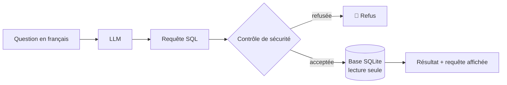

# Accidents de la route en France — 2024
### De la donnée brute à un assistant IA

Ce projet se déroule en deux temps :
1. **Analyse de données** : une chaîne ETL, des analyses en SQL et un dashboard pour comprendre **quand**, **où**, **qui**, et surtout **ce qui rend un accident plus grave**.
2. **Assistant IA** : un LLM local qui répond en français à des questions sur la base (*text-to-SQL*) et rédige des résumés par département. Sa fiabilité est **mesurée** sur un jeu de test.

👉 **[Voir le dashboard en ligne](https://road-accident-france-2024.streamlit.app/)** · 🎬 **[Voir la démo de l'assistant IA](#démonstration)**


---

## Partie 1 — Analyse de données

### Les données

Source : [ONISR — Bases de données annuelles des accidents corporels de la circulation routière](https://www.data.gouv.fr/datasets/bases-de-donnees-annuelles-des-accidents-corporels-de-la-circulation-routiere-annees-de-2005-a-2024) (data.gouv.fr, licence ouverte).

| Fichier | Une ligne = | Lignes |
|---|---|---|
| `caract-2024.csv` | un accident (date, heure, lieu, luminosité, météo) | 54 402 |
| `usagers-2024.csv` | une personne impliquée (âge, sexe, gravité) | 125 187 |

Les deux fichiers sont liés par l'identifiant d'accident `Num_Acc` (relation un-à-plusieurs : 2,3 personnes impliquées par accident en moyenne).

### Démarche

1. **Exploration** (`notebook/01_eda.ipynb`) : structure, types, valeurs manquantes, clé de liaison.
2. **Nettoyage et chargement — ETL** (`notebook/02_cleaning.ipynb`) :
   - conversion des coordonnées GPS (virgule décimale → point) ;
   - extraction de l'heure, construction de la date et du jour de la semaine ;
   - traduction des codes en libellés lisibles, à partir de la documentation officielle ;
   - les codes `-1` (« non renseigné ») deviennent de vraies valeurs manquantes, pour ne pas fausser les calculs ;
   - chargement dans une base **SQLite** (2 tables : `accidents`, `usagers`).
3. **Analyse en SQL** (`notebook/03_analyse.ipynb`) : `GROUP BY`, `CASE WHEN`, jointure entre les deux tables.
4. **Dashboard** (`tableau_de_bord.py`) : Streamlit + Plotly, avec un filtre par département. Les graphiques des notebooks ne s'affichent pas sur GitHub ; ils sont visibles dans le dashboard.

### Résultats clés

- **Quand ?** Deux pics d'accidents, à 8 h et à 17 h (le maximum, 4 607 accidents), qui correspondent aux trajets domicile-travail. Le vendredi est le jour le plus accidentogène.
- **Volume ≠ danger.** 65 % des accidents ont lieu le jour, mais la nuit est plus meurtrière : **3,55 % des personnes impliquées y sont tuées, contre 2,37 % le jour** (+50 %).
- **Hors agglomération, un accident est 3,2 fois plus meurtrier** qu'en ville (4,69 % de tués contre 1,47 %), probablement en raison de vitesses plus élevées. **La nuit hors agglomération, la part de tués atteint 6,12 %**, plus du double de la moyenne nationale.
- **Grandes villes ≠ départements les plus dangereux.** Les métropoles concentrent les accidents, mais les départements ruraux ont une part de tués plus élevée.
- **Les 65 ans et plus sont les plus vulnérables** : 6,61 % des personnes impliquées sont tuées, soit 3 fois plus que les 25-44 ans (2,17 %).
- **498 piétons tués**, soit 14,5 % des 3 432 tués.

### Limites

- Une seule année (2024) : impossible de parler de tendance.
- On mesure la gravité **parmi les personnes impliquées dans un accident**, pas un risque par kilomètre parcouru : les données de trafic ne sont pas disponibles ici.
- L'outre-mer est inclus dans les chiffres, mais la carte se limite à la métropole pour rester lisible.

---

## Partie 2 — Assistant IA

L'assistant tourne **en local** avec [Ollama](https://ollama.com) et le modèle `qwen2.5-coder:7b` : aucune donnée n'est envoyée à un service externe. Il n'est donc pas disponible dans la version en ligne. Voir la démonstration ci-dessous.

### Démonstration

https://github.com/user-attachments/assets/631ec59f-c93b-4c76-86d6-6c0debe5feb9


### Deux fonctionnalités

**1. Poser une question en français** (`notebook/06_text_to_sql.ipynb`)



*« Combien de piétons ont été tués la nuit ? »* → le modèle écrit la requête SQL, et **la base calcule la réponse** : les chiffres ne sont jamais inventés par le modèle. La requête exécutée est toujours affichée, pour pouvoir la vérifier.

**2. Résumé automatique d'un département** (`notebook/05_resume_departement.ipynb`)

Le code calcule les chiffres en SQL **et fait toutes les comparaisons** (« 3,9 fois plus », « inférieure à la moyenne »). Le LLM se contente de rédiger. Un garde-fou vérifie ensuite que chaque nombre du texte provient bien des données, et la fiche de faits est affichée à côté du résumé.

### Principes de conception

| Principe | Mise en œuvre |
|---|---|
| **Le code calcule, le LLM rédige** | les chiffres viennent toujours de SQL, jamais du modèle |
| **Donner le bon contexte** | description de la base générée automatiquement, avec les valeurs possibles de chaque colonne (`'Tué'`, `'Nuit'`…) |
| **Apprendre par l'exemple (*few-shot*)** | trois questions avec leur bonne requête dans le prompt |
| **Défense en profondeur** | connexion en **lecture seule** + contrôle du texte de la requête (une seule instruction `SELECT`, aucun mot-clé dangereux) |
| **Transparence** | requête SQL et fiche de faits toujours affichées |
| **Reproductibilité** | `temperature = 0` et `seed` fixée : même question, même réponse |

### Évaluation (`notebook/07_evaluation.ipynb`)

Une requête valide mais fausse ne produit aucune erreur : c'est une **erreur silencieuse**. Pour la détecter, l'assistant est évalué sur un **jeu de test de 22 questions** (`evaluation/jeu_de_test.json`), chacune associée à une requête de référence écrite à la main. Les résultats sont comparés valeur par valeur.

| Modèle | Bonnes réponses | Temps moyen par question |
|---|---|---|
| `qwen2.5-coder:7b` | **95 %** (21/22) | 12,1 s |
| `qwen2.5:3b` | 68 % | 8,8 s |

**Ce que l'évaluation a permis de corriger :** le modèle cherchait « Paris » dans la colonne `com`, qui contient des codes INSEE, et renvoyait 0 sans aucune erreur. Le contexte a été enrichi (aucun nom de lieu dans la base, conversion en code de département). La correction a ensuite été validée sur **de nouvelles questions** (Gironde, Bouches-du-Rhône), pour ne pas se contenter de réussir la question qui avait échoué.

**Ce que la première version du résumé a appris :** un modèle peut se tromper **sans inventer un seul chiffre**. Il peut inverser une comparaison (« 1,36 %, soit plus que 2,74 % »), mal interpréter un pourcentage ou placer un vrai chiffre au mauvais endroit. D'où la décision de faire toutes les comparaisons dans le code.

### Limites

- 95 % n'est pas 100 % : c'est pourquoi la requête SQL est toujours affichée.
- Le garde-fou du résumé vérifie les **nombres**, pas le **sens** des phrases.
- Environ 12 secondes par question sur un PC portable sans GPU.
- Fonctionne uniquement en local : pas d'IA dans la version en ligne.

---

## Structure du projet

```
├── app.py                  # point d'entrée : menu des deux pages
├── tableau_de_bord.py      # page « Tableau de bord »
├── assistant_ia.py         # page « Assistant IA »
├── assistant.py            # text-to-SQL : contexte, génération, sécurité
├── resume.py               # résumé automatique d'un département
├── data/accidents.db       # base SQLite (produite par le notebook 02)
├── evaluation/
│   └── jeu_de_test.json    # 22 questions + requêtes de référence
├── notebook/
│   ├── 01_eda.ipynb … 03_analyse.ipynb           # partie 1 : analyse de données
│   └── 04_llm_discovery.ipynb … 07_evaluation.ipynb   # partie 2 : assistant IA
└── docs/                   # captures d'écran
```

## Lancer le projet

```bash
python -m venv .venv
.venv\Scripts\activate          # Windows
pip install -r requirements.txt
streamlit run app.py
```

Pour l'assistant IA : installer [Ollama](https://ollama.com), puis `ollama pull qwen2.5-coder:7b`.

Pour reconstruire la base : télécharger les deux CSV dans `data/raw/`, puis exécuter `notebook/02_cleaning.ipynb`.

## Compétences mobilisées

**Data :** Python · pandas · SQL (SQLite) · ETL · Plotly · Streamlit · Git
**IA :** LLM en local (Ollama) · *prompt engineering* · *few-shot* · *text-to-SQL* · évaluation de LLM · sécurité des sorties d'un modèle

## Auteur

**Isaac LEVY** — Étudiant en Master Expert IA & Data Science, en recherche d'alternance.
[LinkedIn](https://www.linkedin.com/in/isaac-levy-landa)
