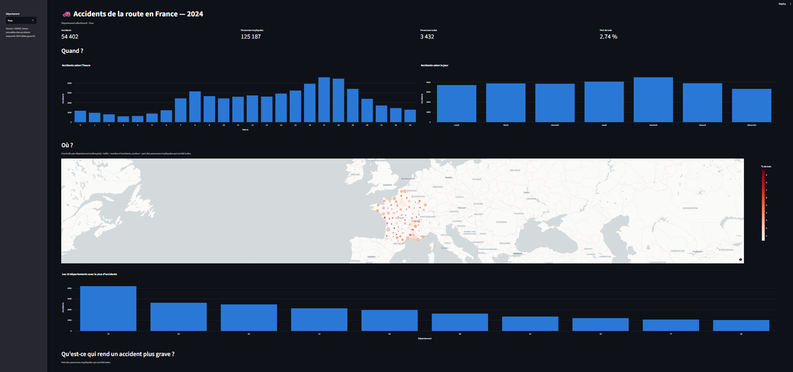

# Accidents de la route en France — 2024

Analyse des accidents corporels de la circulation routière en France en 2024 : **quand**, **où**, **qui**, et surtout **qu'est-ce qui rend un accident plus grave ?**

👉 **[Voir le dashboard en ligne](https://road-accident-france-2024.streamlit.app/)**



## Les données

Source : [ONISR — Bases de données annuelles des accidents corporels de la circulation routière](https://www.data.gouv.fr/datasets/bases-de-donnees-annuelles-des-accidents-corporels-de-la-circulation-routiere-annees-de-2005-a-2024) (data.gouv.fr, licence ouverte).

Deux fichiers de l'année 2024 :

| Fichier | Une ligne = | Lignes |
|---|---|---|
| `caract-2024.csv` | un accident (date, heure, lieu, luminosité, météo) | 54 402 |
| `usagers-2024.csv` | une personne impliquée (âge, sexe, gravité) | 125 187 |

Les deux fichiers sont liés par l'identifiant d'accident `Num_Acc` (relation un-à-plusieurs : 2,3 personnes impliquées par accident en moyenne).

## Démarche

1. **Exploration** (`notebooks/01_eda.ipynb`) : structure, types, valeurs manquantes, clé de liaison.
2. **Nettoyage et chargement — ETL** (`notebooks/02_cleaning.ipynb`) :
   - conversion des coordonnées GPS (virgule décimale → point) ;
   - extraction de l'heure, construction de la date et du jour de la semaine ;
   - traduction des codes en libellés lisibles, à partir de la documentation officielle ;
   - les codes `-1` (« non renseigné ») deviennent de vraies valeurs manquantes, pour ne pas fausser les calculs ;
   - chargement dans une base **SQLite** (2 tables : `accidents`, `usagers`).
3. **Analyse en SQL** (`notebooks/03_analyse.ipynb`) : `GROUP BY`, `CASE WHEN`, jointure entre les deux tables.
4. **Dashboard** (`app.py`) : Streamlit + Plotly, avec un filtre par département.

## Résultats clés

- **Quand ?** Deux pics d'accidents, à 8 h et à 17 h (le maximum, 4 607 accidents), qui correspondent aux trajets domicile-travail. Le vendredi est le jour le plus accidentogène.
- **Volume ≠ danger.** 65 % des accidents ont lieu le jour, mais la nuit est plus meurtrière : **3,55 % des personnes impliquées y sont tuées, contre 2,37 % le jour** (+50 %). Il y a moins de trafic la nuit, mais les accidents y sont plus graves.
- **Hors agglomération, un accident est 3,2 fois plus meurtrier** qu'en ville (4,69 % de tués contre 1,47 %), probablement en raison de vitesses plus élevées.
- **Les 65 ans et plus sont les plus vulnérables** : 6,61 % des personnes impliquées sont tuées, soit 3 fois plus que les 25-44 ans (2,17 %).
- **498 piétons tués**, soit 14,5 % des 3 432 tués.

## Limites

- Une seule année (2024) : impossible de parler de tendance.
- On mesure la gravité **parmi les personnes impliquées dans un accident**, pas un risque par kilomètre parcouru : les données de trafic ne sont pas disponibles ici.
- Les données d'outre-mer sont incluses dans les chiffres, mais la carte se limite à la métropole pour rester lisible.

## Lancer le projet

```bash
python -m venv .venv
.venv\Scripts\activate          # Windows
pip install -r requirements.txt
streamlit run app.py
```

Pour reconstruire la base : télécharger les deux CSV dans `data/raw/`, puis exécuter `notebooks/02_cleaning.ipynb`.

## Compétences mobilisées

Python · pandas · SQL (SQLite) · ETL · Plotly · Streamlit · Git
